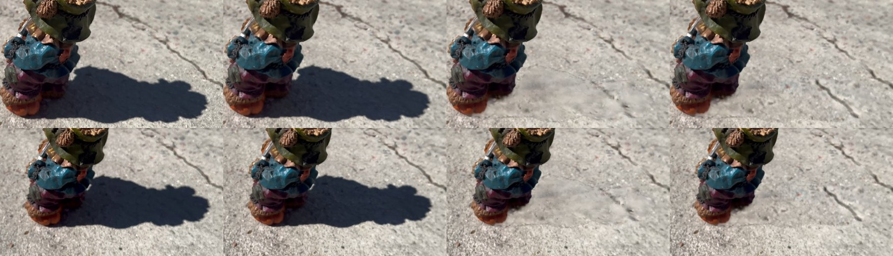
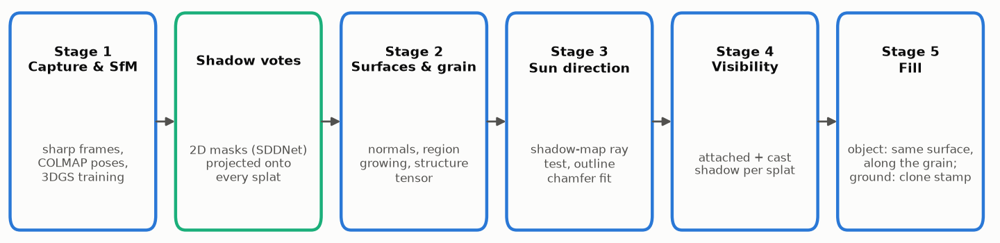
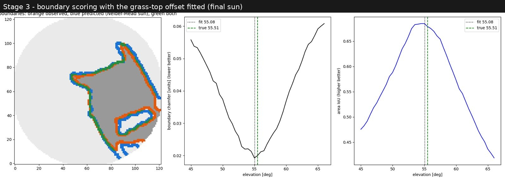
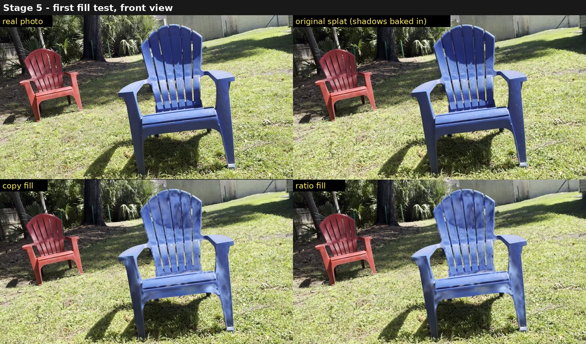
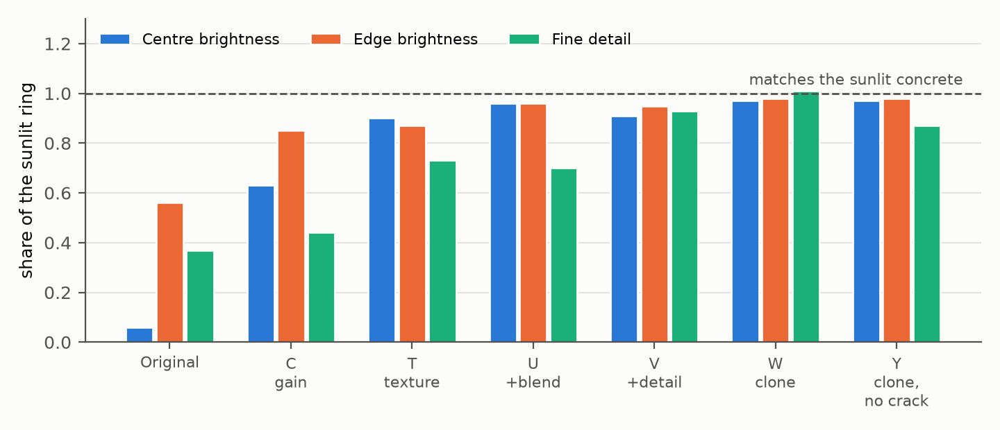
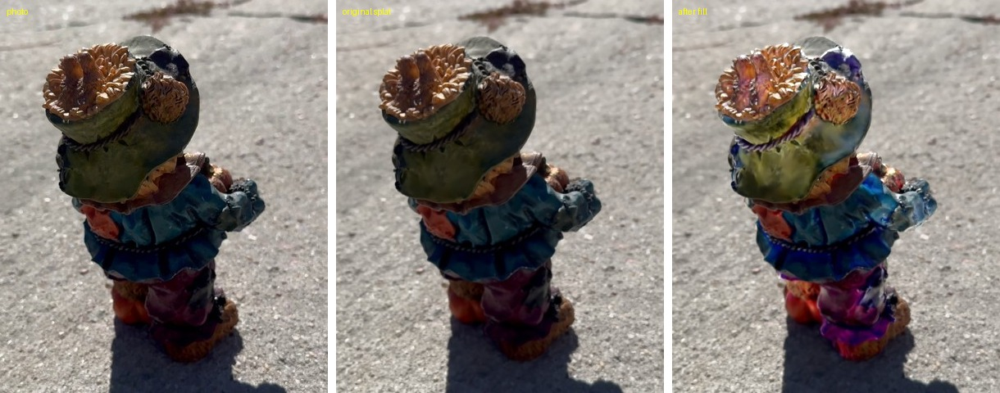

# Shadow-Free Gaussian Splatting

**Removing baked-in sun shadows from a finished 3D Gaussian splat captured with a single phone video.**

Bhanu Singh · ongoing research, 2026 · [Paper (preprint PDF)](paper/shadow_free_gaussian_splatting_preprint.pdf)


<sub>Left to right: real photo, original splat (shadow baked in), colour-only fill (U), geometry clone stamp (W). The clone stamp brings the shadowed concrete back to 97% of the surrounding sunlit brightness, with its cracks and grain.</sub>

---

## The problem

A 3D Gaussian splat is a scene stored as millions of small, soft, coloured blobs, trained so that their renders match
the photos. The blobs record exactly what the camera saw, **including the shadows of that moment**. When the scene is
moved into Blender or Unreal Engine and lit differently, those painted-on shadows look wrong.

Most published work on this (relightable and inverse-rendering splats) retrains the scene and separates materials from
lighting, which usually needs captures under several lighting conditions. This project takes a different route.

## The idea

Treat shadow removal as **surface-aware repainting of a finished splat**, with no retraining:

1. find where the sun was, from the geometry of the object's own cast shadow;
2. work out which blobs the sun could not reach;
3. repaint those blobs from sunlit blobs **on the same surface, along the surface's texture direction (grain)**;
4. on the ground, replace shadowed blobs with copies of nearby sunlit ones (a 3D "clone stamp").

The whole pipeline (concept, method design and experiments) is my own work.



| Stage | What it does, in plain words |
|---|---|
| **1. Capture and reconstruction** | Pick about 650 sharp frames from a phone video, recover the camera positions (COLMAP), and train the splat (nerfstudio splatfacto). |
| **Shadow votes** | A shadow-detection network (SDDNet) marks shadow pixels in every photo; each blob collects a shadow/lit vote from every photo that sees it. |
| **2. Surfaces and grain** | Group blobs into continuous surfaces (each slat, leg, patch of ground) and measure each surface's texture direction. |
| **3. Sun direction** | Try many sun directions, cast the object's shadow onto the ground in 3D, and keep the one whose shadow outline best matches the photos. |
| **4. Visibility** | For every blob, decide whether it is sunlit, in attached shadow (faces away from the sun) or in cast shadow (blocked). |
| **5. Fill** | Repaint shadowed object blobs from sunlit blobs of the same surface, searched along the grain. On the ground, clone sunlit blobs (colour and geometry) into the shadow. |

A longer plain-language walkthrough, written for readers who are not splatting specialists, is in
[docs/shadow-free-explained.md](docs/shadow-free-explained.md).

## Results so far

### Experiment 1: plastic chair on grass

**Sun direction from the shadow alone:** 55.08° elevation against 55.51° computed from GPS and capture time (0.43° off).


<sub>Observed (orange) and predicted (blue) shadow outlines agree to about 1.5 cm; the boundary score has a sharp minimum next to the true sun.</sub>


<sub>First repainting test: the dark arc on the backrest is lifted. Two fill modes are compared.</sub>

### Experiment 2: painted bear figurine on concrete

**Ground shadow:** a per-blob brightness gain lifts the shadow only to 63% of the surrounding sunlit concrete. The
geometry clone stamp reaches 97%, with fine detail restored to 87-101% of the surrounding concrete.



A finding along the way: the residual smudge left by colour-only fills comes from **geometry, not colour**. Blobs
trained on the dark shadow are 1.7 times larger than blobs on sunlit concrete, so the fix has to replace them, not
recolour them.

### Honest negative results

These are reported in full in the paper, because they show where the method stops working:

- **Bear object fill failed.** On a multi-coloured, curved, sculpted figurine there is little grain to follow, and
  dark paint is easily mistaken for shade; the repainted hat and clothes turned purple and blue.
  
- **Sun from the bear's shadow** came out 4.98° high; the shadow is small and the outline grid is coarse at that scale.
- **Off-the-shelf inverse rendering does not solve it.** GS-IR kept hard sun shadows in its albedo, and
  GaussianShader relights only reflections.

### Current work (after the preprint, not yet written up)

A second bear (16 cm, filmed on concrete) runs end to end with one command in about 1 h 52 min, with no hand-set values.
Since then:

- A flat-surfel (2DGS) copy of the scene gives reliable surface directions: 69.8% of the bear's blobs now have a
  confident direction, up from 19.7%, at near-identical image quality (PSNR 28.16 vs 28.45).
- With only the object's own surfels allowed to cast shadows, the refitted sun is 44.97° elevation against 44.47° from
  the video's GPS metadata, and the predicted ground shadow matches the photos with an overlap (IoU) of 0.87.
- Open problem: blobs that sat in shade store the wrong colour, so brightness-only fills cannot recover the paint.
  A full BRDF decomposition (R3DG) was tried and also baked the shadow into the paint colour; this is the next
  thing to solve.

The day-by-day record is in [docs/status.md](docs/status.md) and the full run log in [docs/lab-notes.md](docs/lab-notes.md).

## What is new compared with published work

- **Training-free:** edits a finished splat (colour only for objects, colour and geometry for the ground) in seconds
  per fill, instead of retraining per scene.
- **One capture, one lighting:** no multi-illumination capture and no satellite or weather metadata needed.
- **Sun from the splat's own cast-shadow outline**, fitted in 3D across all views.
- **Same-surface, grain-guided repainting** of shadowed blobs, and a **geometry clone stamp** for ground shadows.
- **Shadow detector fine-tuned on labels projected from the 3D result**, with no hand labelling
  (on held-out chair frames, agreement with the 3D labels rose from IoU 0.22 to 0.55).

Related work (R3DG, GS-IR, NeRF-OSR, LumiGauss, GaRe, ShadowGS and others) is discussed in Section 2 of the paper.

## Paper

**Shadow-Free Gaussian Splatting: Sun Estimation from Cast-Shadow Geometry and Surface-Aware Inpainting of 3D Gaussian
Splats.** Bhanu Singh, 2026. Preprint, in preparation for arXiv (cs.CV).
[PDF](paper/shadow_free_gaussian_splatting_preprint.pdf) · [abstract and citation](paper/README.md)

## Repository layout

```
paper/        preprint PDF, abstract and citation
figures/      the images used on this page
docs/         plain-language explainer, run-by-run lab notes, current status, setup guides
  shadow-free-explained.md        the pipeline explained step by step
  lab-notes.md                    every run, error, fix and number
  status.md                       where the work stands now
  video-to-splat-pipeline.md      stage 1 tooling: phone video -> trained splat
  figures/                        labelled test images for each stage
scripts/      all code, listed by stage in scripts/README.md
  runs/       the exact run scripts behind each result
environment.yml
```

## Reproducing

Stage 1 (video to splat) needs an NVIDIA GPU; it was developed on an 8 GB RTX 4070 laptop and scaled up on a 96 GB
RTX PRO 6000. Setup and commands: [docs/video-to-splat-pipeline.md](docs/video-to-splat-pipeline.md) and
[docs/quickstart.md](docs/quickstart.md). The shadow-free stages are Python scripts that run on the exported splat;
[scripts/README.md](scripts/README.md) lists them by stage, and `scripts/runs/run_full_6705.sh` runs the whole
pipeline on one video.

Built on [nerfstudio](https://docs.nerf.studio/), [gsplat](https://github.com/nerfstudio-project/gsplat),
[COLMAP](https://colmap.github.io/) and SDDNet (ACM MM 2023).

## Contact

Bhanu Singh · GitHub [@thebhanusingh](https://github.com/thebhanusingh)
