# Test figures: shadow-free splat, IMG_6556 chair (2026-10-12/13)

Key images from the laptop tests, downsized to 1600 px wide, each with its label burned in. Numbers and full
details are in `docs/lab-notes.md` (sections Stage 2, 3, 4, 4b, 4c, 4d). Sun reference: 55.51 deg elevation
(GPS + capture time).

## Stage 3: surface clustering and grain

**Stage 3 - chair split into surfaces (one colour per cluster; grey = not clustered). Top-down and two side views.**

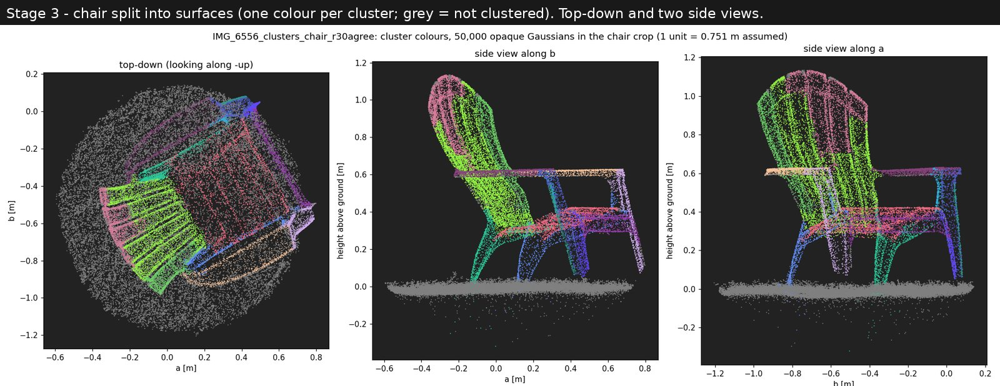

Region growing (--region-angle 30, --normal-source agree) splits the chair into seat, backrest slats, arms and legs.

Source: `exports/IMG_6556_clusters_chair_r30agree/cluster_views.png`

**Stage 3 - grain vs real photo, flat surfaces only (green <20 deg, orange 20-45, red >45 deg off the photo texture)**

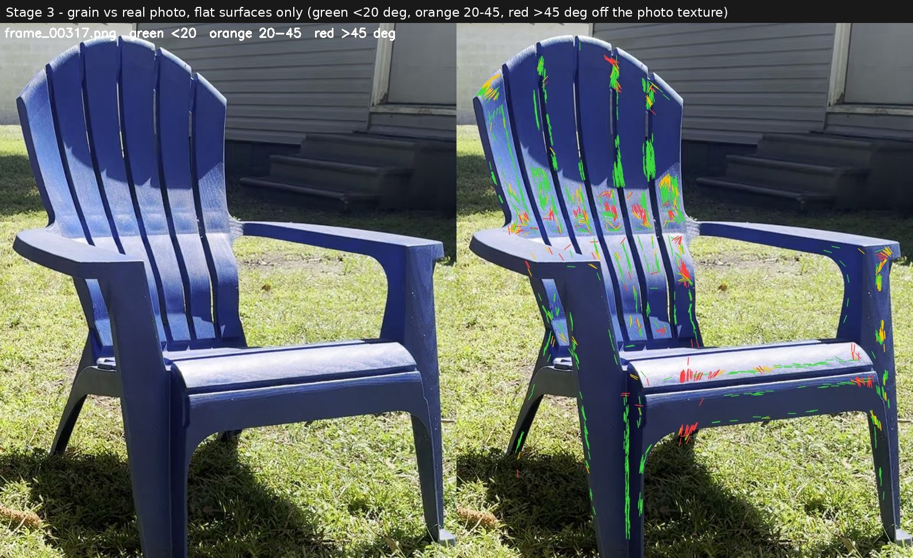

Median 9.1 deg on flat surfaces vs 43.6 deg for random directions and 79.7 deg for grain rotated 90 deg. Red marks cluster on the shadow edge.

Source: `exports/IMG_6556_clusters_chair_r30agree_v3/grain_check_interior/grain_frame_00317.jpg`

**Stage 3 - grain vs real photo, edges and outlines (front view)**

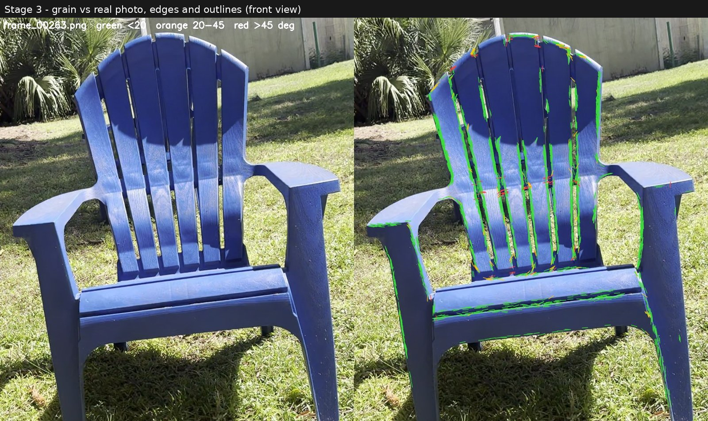

Median 5.5 deg on edges; agreement on outlines is partly built into splat training, so the flat-surface check is the real test.

Source: `exports/IMG_6556_clusters_chair_r30agree_v3/grain_check_edges/grain_frame_00263.jpg`

## Stage 2: sun direction

**Stage 2 - first sun fit, everything casts shadows: observed | predicted | agreement (green both, blue extra)**

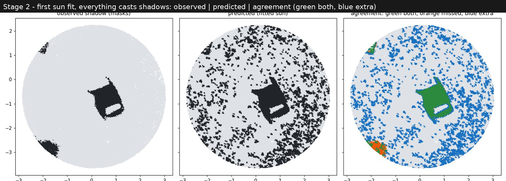

Elevation 57.0 deg vs true 55.51. Grass blades and floaters cast false shadows all over the lawn (blue), IoU 0.14.

Source: `exports/IMG_6556_sun/sun_fit.png`

**Stage 2 - chair-only casters: observed | predicted | agreement**

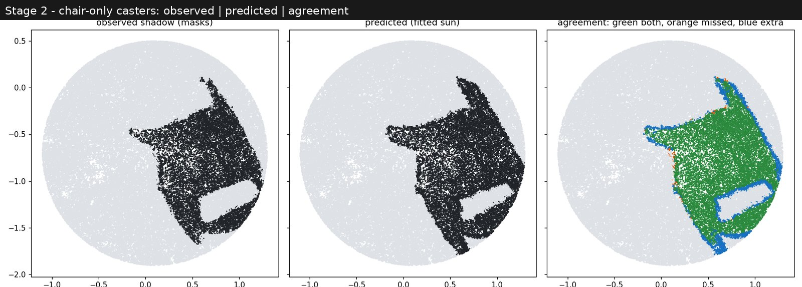

Elevation 55.0 deg (true 55.51); IoU 0.69. The chair's shadow, including the lit gap under the seat, matches closely.

Source: `exports/IMG_6556_sun_chair_s12/sun_fit.png`

**Stage 2 - adding the chair's self-shadow: observed | predicted | agreement on the chair, and IoU vs elevation**

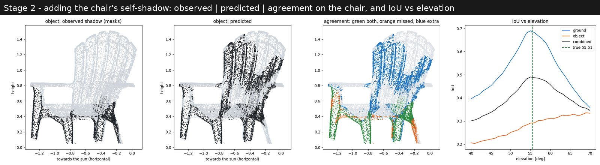

Self-shadow alone did not find the sun (thin slats confuse the votes); combined fit 55.50 deg, uncertainty 2.5 deg.

Source: `exports/IMG_6556_sun_self_oc/sun_self.png`

**Stage 2 - boundary scoring: shadow outlines (orange observed, blue predicted, green both), score vs elevation**

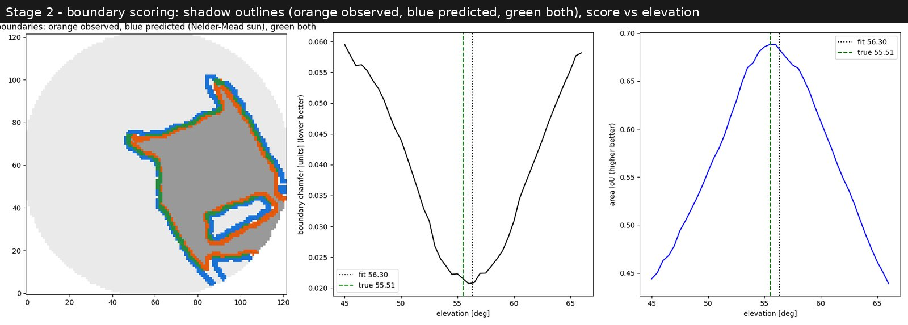

Outlines agree to about 1.5 cm; elevation 56.3 deg; less sensitive to settings than area IoU.

Source: `exports/IMG_6556_sun_edges/sun_edges.png`

**Stage 2 - boundary scoring with the grass-top offset fitted (final sun)**

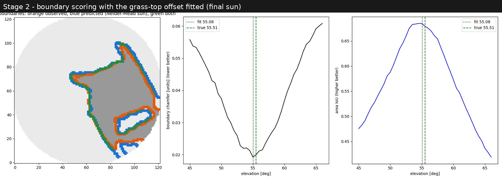

Elevation 55.08 deg vs true 55.51 (-0.43); halves 55.25 / 55.75. The offset itself is only weakly determined on this capture.

Source: `exports/IMG_6556_sun_edges_fitshift/sun_edges.png`

## Stage 4: which Gaussians are in shadow

**Stage 4a - sun geometry prediction, front view: photo | predicted (red shadow, cyan lit) | SDDNet outline**

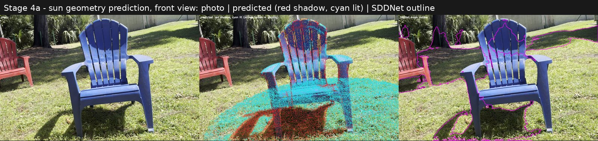

Ground shadow sits on the real shadow (recall 98%). Backrest front is mixed: the sun skims it almost edge-on.

Source: `exports/IMG_6556_shadow4_v2/overlay_frame_00263.jpg`

**Stage 4a - sun geometry prediction, rear view: photo | predicted | SDDNet outline**

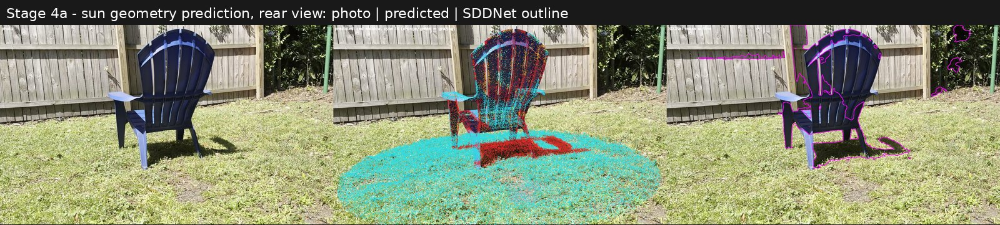

The back of the backrest is dark in the photo, predicted shadow, and SDDNet agrees.

Source: `exports/IMG_6556_shadow4_v2/overlay_frame_00540.jpg`

**Stage 4a - chair side views: observed (mask votes) | predicted | facing away | cast by other parts**

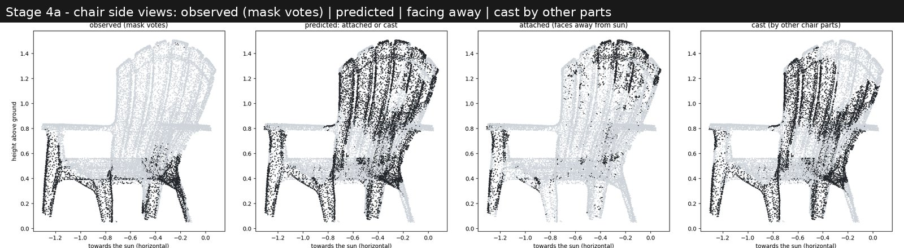

Legs and under-seat agree; backrest front over-predicted.

Source: `exports/IMG_6556_shadow4_v2/shadow4.png`

**Stage 4b - chair brightness vs sun angle, and brightness histogram**

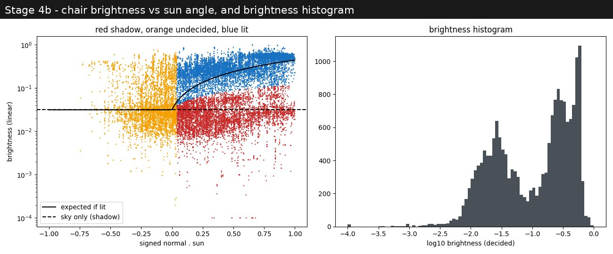

Two clear groups: sunlit about 13x brighter than shade, matching the sun/sky ratio measured on the grass.

Source: `exports/IMG_6556_chairshadow/chair_shadow.png`

**Stage 4b - shadow from photo brightness, front view: photo | detected (red shadow, cyan lit) | SDDNet outline**

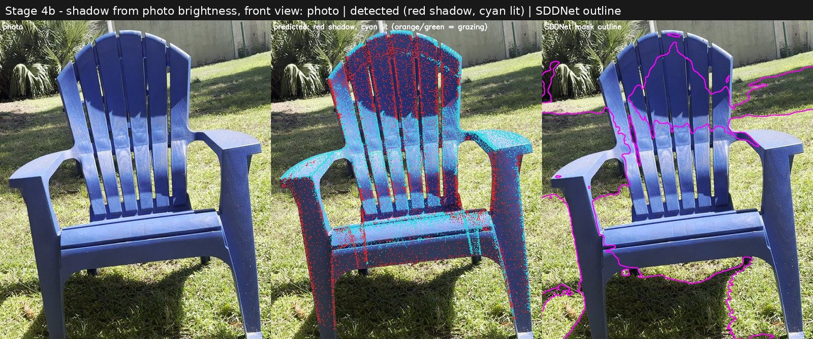

The dark arc on the upper backrest is detected; SDDNet outlines only part of it.

Source: `exports/IMG_6556_chairshadow_photo_s15/overlay_frame_00263.jpg`

**Stage 4b - shadow from photo brightness, three-quarter view**

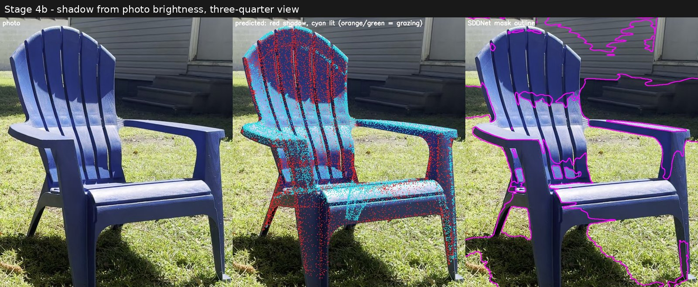

Shaded upper backrest, lit middle band, lit arm tops, shaded inner legs.

Source: `exports/IMG_6556_chairshadow_photo_s15/overlay_frame_00317.jpg`

**Stage 4d - USER'S adjacent brightness-and-colour method, front view: photo | detected | SDDNet outline**

Each spot compared with sunlit neighbours within ~30 cm of the same colour; 44.5% of the chair in shadow.

Source: `exports/IMG_6556_chairshadow_adj_r04/overlay_frame_00263.jpg`

**Stage 4d - USER'S adjacent brightness-and-colour method, three-quarter view**

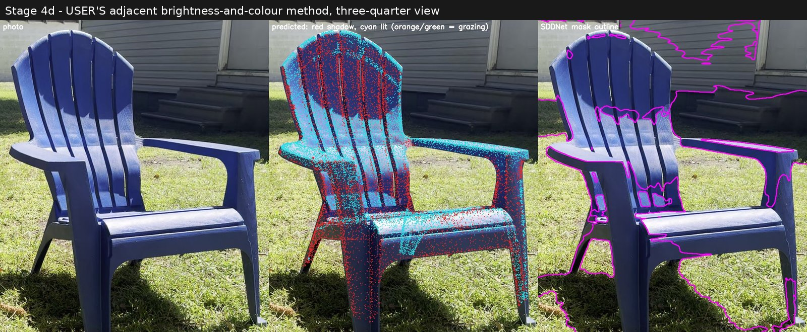

Shadowed plastic is measurably bluer than its sunlit neighbours (sky light); the colour check allows for that.

Source: `exports/IMG_6556_chairshadow_adj_r04/overlay_frame_00317.jpg`

**Stage 4d - USER'S adjacent brightness-and-colour method, rear view**

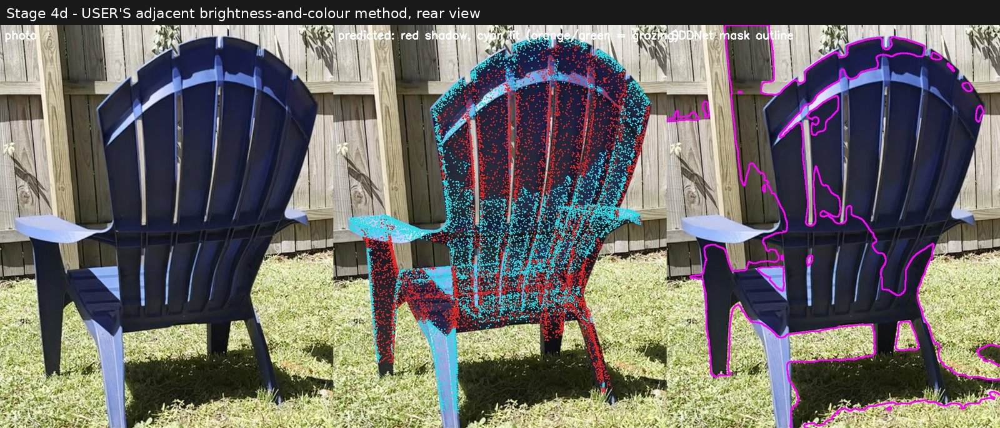

Rear view; some lit front-face points show through the thin slats (display limitation).

Source: `exports/IMG_6556_chairshadow_adj_r04/overlay_frame_00540.jpg`

**Stage 4c - automatic training target: photo | target (red = shadow, yellow outline = ignored)**

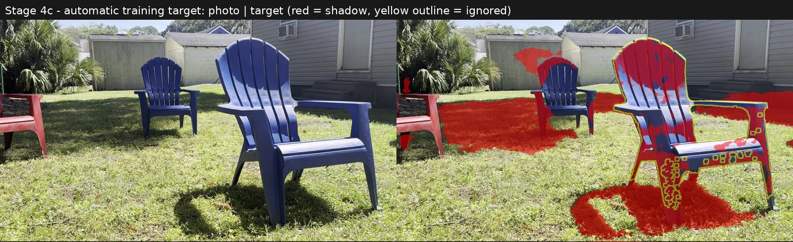

SDDNet's own mask off the chair, our 3D chair labels on the chair; no hand-labelling.

Source: `exports/IMG_6556_chair_targets/check_frame_00325.jpg`

**Stage 4c - held-out frame 649: photo | original SDDNet | retrained SDDNet | our labels (red = shadow)**

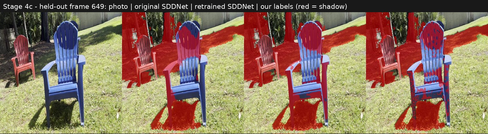

Retrained detector marks the whole backrest arc and inner sides; never saw this frame in training.

Source: `exports/IMG_6556_sddnet_ft/val_frame_00649.jpg`

**Stage 4c - held-out frame 601: photo | original SDDNet | retrained SDDNet | our labels**

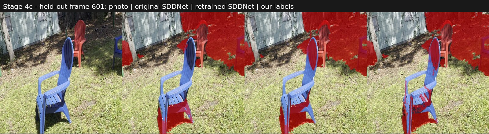

Chair-shadow IoU on held-out frames 0.38 -> 0.64; vs the independent sun geometry 0.21 -> 0.48.

Source: `exports/IMG_6556_sddnet_ft/val_frame_00601.jpg`
